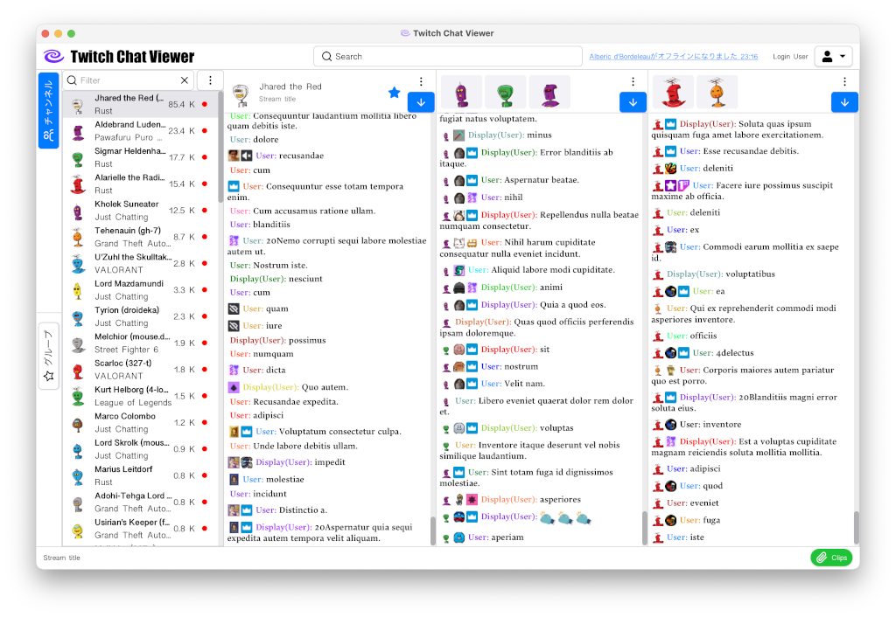
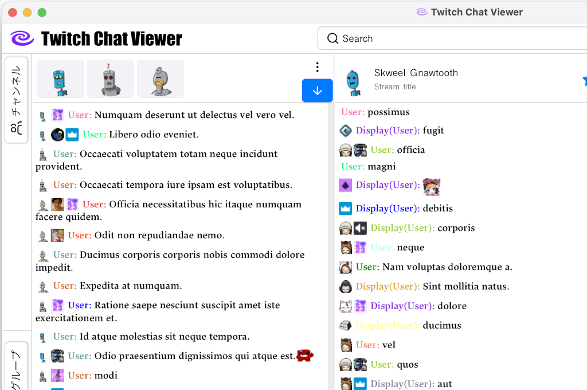
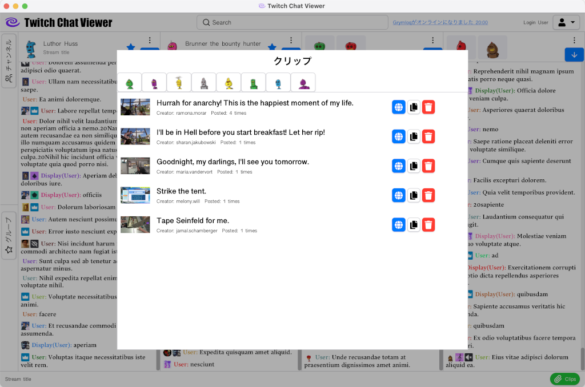
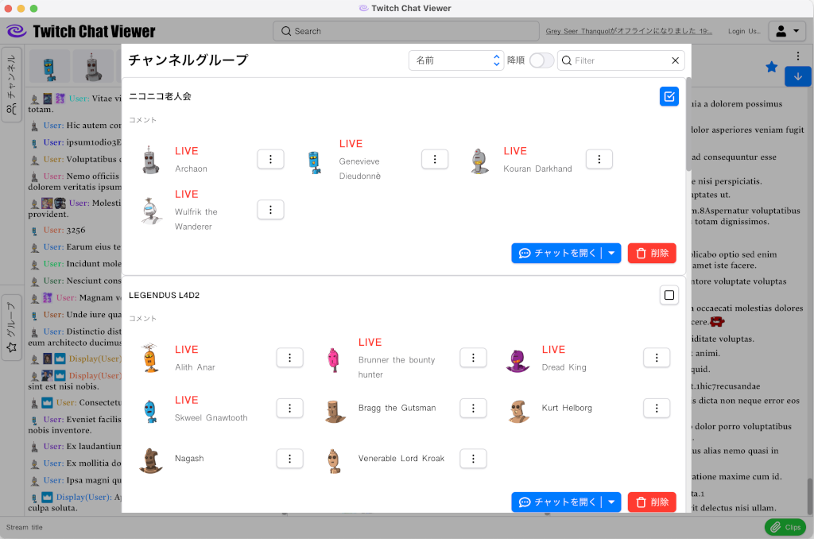

# Twitch Chat Viewer

[](https://github.com/k7t3/TwitchChatViewer/actions/workflows/test.yaml)
[](https://opensource.org/licenses/Apache-2.0)

このアプリケーションはライブストリーミングサービス[Twitch](https://www.twitch.tv/)の非公式チャットビューアです。



[使用方法](docs/usage.md)

## 主な機能

### マルチチャンネルのチャット閲覧
* 複数のチャンネルのチャットを同時に視聴できます。

### チャットのマージ
* 任意のチャットをマージして一つのビューアに集約できます。
  

### チャットビューアのポップアウト
* チャットビューアを透過ウインドウとしてポップアウトして最前面に配置できます。
* 配信画面や作業ウインドウの任意の場所に配置してスペースを有効活用しましょう。


### チャットに投稿されたクリップの検出
* 表示しているチャットに投稿されたクリップを検出できます。
* 投稿された回数を記録しており、ホットなクリップがひと目で確認できます。



### チャンネルのグループ管理
* チャンネルを任意のグループに登録することができます。


### カスタマイズ可能なチャットビューア
* フォントの変更やユーザー名・バッジの表示切り替えなど、チャットビューアをカスタマイズできます。
* 表示領域を最大限有効活用できます。

### チャットメッセージのフィルタリング
* 特定のユーザーのメッセージを非表示にしたり、正規表現を使用してフィルタリングできます。

## 資格情報の保存

資格情報の暗号化鍵は、macOSではキーチェーン、WindowsではCredential Manager、LinuxではSecret Serviceを使って保護します。
Linuxではlibsecret 0.19.0以上と、ログイン中のセッションD-Busで利用できるSecret Serviceが必要です。
画面表示にはGTK 3.20以上とXTestライブラリも必要です。DEBはこれらに加え、対象JavaFXのネイティブ資源から読み取ったglibcの最小版を宣言します。現在のJavaFX 27.0.1ではARM64版がglibc 2.38以上を要求します。
OSの保管先を利用できない場合は保存・復号を失敗として扱い、共通パスワードへ切り替えません。

旧既定パスワード形式の鍵ファイルは、初回の鍵利用時にOS保護形式へ移行します。
鍵ファイルだけを別環境へコピーしても復号できません。JVMプロパティ`key.manager.password`を明示した場合は、従来のパスワード方式を維持します。

## 開発とビルド

JDK 25 をインストールしてください。コンパイル・テスト・`jdeps`・`jpackage` は、
Gradle の Java toolchain で同じ Java 25 を選択します。Gradle Wrapper は 9.8.2 です。
Java・JavaFX・テストライブラリのバージョンは `gradle/libs.versions.toml` で管理します。
ヘッドレステストは JavaFX 27 の描画基盤を使います。

構築・所有・終了順は[アーキテクチャ](docs/architecture.md)、改善の進捗と検証範囲は[技術的負債の監査](docs/technical-debt.md)を参照してください。

```bash
./gradlew -p buildSrc test        # パッケージ生成ロジックのテスト
./gradlew test                   # ヘッドレスで全アプリテスト
./gradlew -Pheadless=false test  # デスクトップ上の実ウインドウを使うテスト
./gradlew run                    # アプリの起動
```

実macOSの連携テストは、専用の一時キーチェーンへ合成データを書き込み、最後に削除します。通常のテストからは除外し、明示指定した場合だけ実行します。

```bash
./gradlew -PosKeychainTests=true test --tests '*MacKeychainSecretStoreTest'
```

配布物は生成する OS 上でビルドします。`make` は Windows では EXE、macOS では DMG、
Linux では DEB を生成します。OS ごとの外部ツールは [JDK 25 の jpackage 仕様](https://docs.oracle.com/en/java/javase/25/docs/specs/man/jpackage.html)を参照してください。

```bash
./gradlew "-Papp.version=1.2.3-rc.1" appImage  # build/app-image に実行イメージを生成
./gradlew "-Papp.version=1.2.3-rc.1" make      # build/app にインストーラーを生成
```

版番号は `major.minor.patch` と任意の `-suffix` / `+metadata` です。
ネイティブの版番号には数値3要素を使い、アプリには完全な版番号を渡します。
配布入力は専用ディレクトリへ同期し、生成成功後に直前の出力を置換します。
生成失敗時には直前の出力を保持し、置換の復旧にも失敗した場合はバックアップの場所を報告します。
公開・署名証明書による署名・公証は別途行います。

GitHub Actions の手動配布ビルドでは、既存の `v1.2.3` 形式のタグを指定します。
指定タグからビルドし、同じタグのドラフトリリースを作成します。

## License

詳細は [LICENSE](LICENSE.md) を参照してください。
